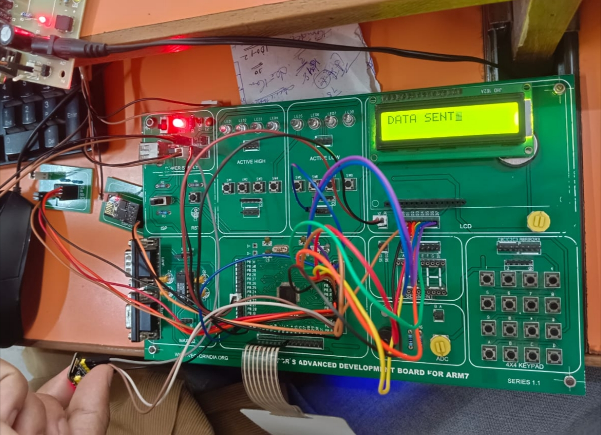
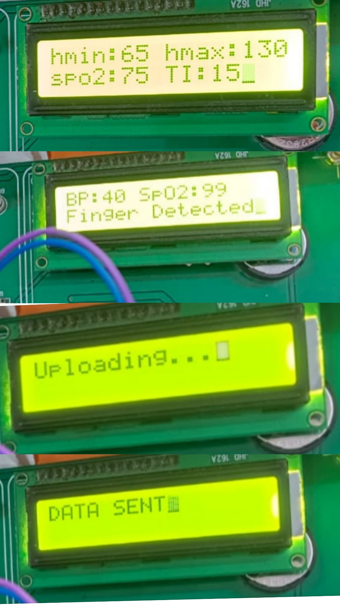
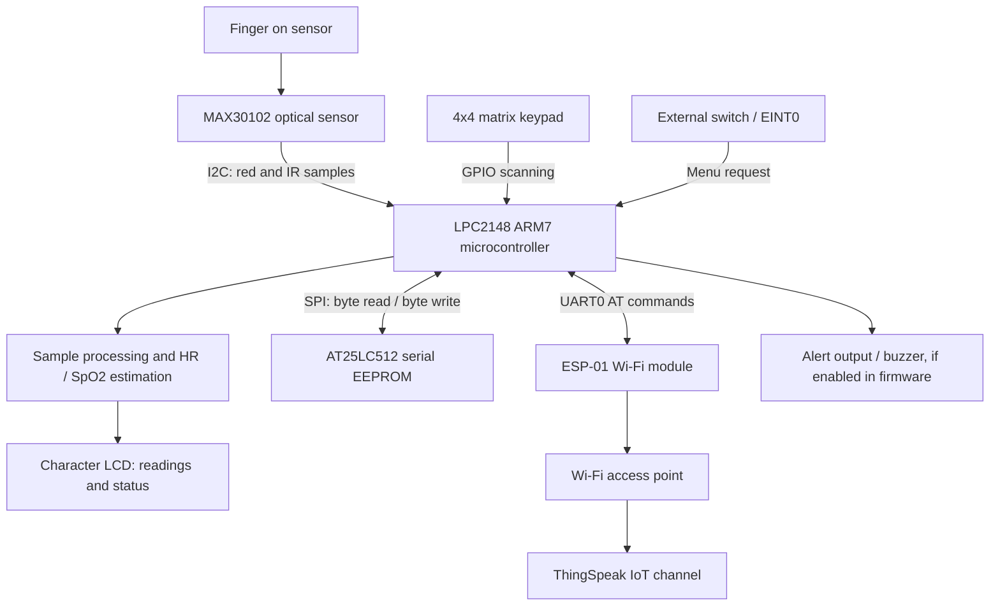



# PulseGuard
### IoT-Based Heart Rate and SpO₂ Monitoring System

**LPC2148 ARM7 • Embedded C • MAX30102 • ESP-01 • ThingSpeak**

---

## Table of Contents

- [Project Overview](#project-overview)
- [Aim and Objectives](#aim-and-objectives)
- [Demonstration and Output Images](#demonstration-and-output-images)
- [Block Diagram](#block-diagram)
- [Hardware and Software Requirements](#hardware-and-software-requirements)
- [Hardware Connections](#hardware-connections)
- [Main Features](#main-features)
- [Working Principle](#working-principle)
- [Settings Menu and EEPROM](#settings-menu-and-eeprom)
- [Firmware Structure](#firmware-structure)
- [Build and Flashing](#build-and-flashing)
- [Testing Checklist](#testing-checklist)
- [Limitations and Safety](#limitations-and-safety)
- [Future Enhancements](#future-enhancements)
- [Author](#author)

## Project Overview

**PulseGuard** is an educational embedded-systems project designed to monitor estimated heart rate and peripheral oxygen saturation (SpO₂). The LPC2148 ARM7 microcontroller interfaces with the MAX30102 optical sensor, processes red and infrared (IR) samples, and displays status and readings on a character LCD. A keypad allows the user to edit configured limits and the upload interval. The ESP-01 Wi-Fi module provides the communication path to ThingSpeak, while an AT25LC512 serial EEPROM stores selected settings so they can persist after power is removed.

> **Important:** This is an educational prototype, not a certified medical device. Its readings and alerts are not intended for diagnosis, treatment, or emergency decisions.

## Aim and Objectives

The aim is to develop an IoT-based monitoring prototype that:

- Acquires red and IR optical samples from the MAX30102.
- Estimates heart rate in beats per minute (BPM) and SpO₂ as a percentage using firmware algorithms.
- Displays sensor status, settings, and readings locally on an LCD.
- Allows configurable lower/upper heart-rate limits, a lower SpO₂ limit, and an upload interval.
- Stores configuration in non-volatile EEPROM.
- Sends measurement data to an IoT platform through ESP-01 Wi-Fi connectivity.
- Indicates an abnormal reading according to the configured thresholds.

## Demonstration and Output Images

### Complete hardware setup

*Actual project setup photograph. The LPC2148 ARM7 development board, LCD, keypad area, jumper wires, and connected modules are visible.*

### LCD outputs

The submitted photographs show these display states:

1. **Settings screen** — `hmin`, `hmax`, `spo2`, and `TI` configuration values.
2. **Sensor status** — `Finger Detected` and displayed sensor-related values.
3. **Upload progress** — `Uploading...`.
4. **Send status** — `DATA SENT`.

**Interpretation note:** The photo displays `BP:40`. BP commonly means blood pressure, but this project's stated purpose is heart-rate and SpO₂ monitoring. Check the firmware label and variable before documenting this as BPM. A `DATA SENT` LCD message indicates the firmware's status message; verify the ThingSpeak channel independently to confirm server-side receipt.

## ☁️ ThingSpeak IoT Cloud Output

PulseGuard uses the ESP-01 Wi-Fi module to send heart-rate (BPM) and oxygen-saturation (SpO₂) readings to the ThingSpeak IoT cloud platform for remote monitoring and visualization.

### 3. ThingSpeak Dashboard

### 4. Heart Rate and SpO₂ Graphs

### 5. ThingSpeak Heart Rate and SpO₂ Monitoring

## Block Diagram

**Data flow:** MAX30102 samples → LPC2148 acquisition and calculations → LCD display and threshold checks → scheduled ESP-01/ThingSpeak transmission. The keypad and external interrupt provide user input; EEPROM holds configuration values. The diagram represents the intended system architecture—confirm exact runtime behavior against the source code and hardware.

## Hardware and Software Requirements

### Hardware components

| # | Component | Role in the project | Notes |
|---:|---|---|---|
| 1 | LPC2148 ARM7 development board | Main controller; runs Embedded C firmware | The supplied project targets the LPC21xx family. |
| 2 | MAX30102 optical sensor module | Red/IR sampling for HR and SpO₂ estimation | Connected using I²C. Confirm the module's voltage requirements and logic compatibility. |
| 3 | Character LCD (16×2 in the photos) | Displays settings, readings, and status messages | Firmware configures an 8-bit data interface. |
| 4 | 4×4 matrix keypad | Enters numeric settings and navigates the menu | GPIO row/column scanning. |
| 5 | External switch | Requests the settings menu using EINT0 | Firmware configures an external interrupt. |
| 6 | ESP-01 Wi-Fi module | Provides Wi-Fi connectivity using UART AT commands | Requires a suitable regulated supply and compatible logic levels. |
| 7 | AT25LC512 SPI EEPROM | Stores configuration values in non-volatile memory | Serial SPI memory; separate from the MAX30102 I²C bus. |
| 8 | DB-9 serial cable / USB-UART interface | Serial terminal access and/or board programming/debug communication | Use the correct interface and voltage levels for the board. |
| 9 | Jumper wires | Connects modules and board headers | Verify every connection before powering. |
| 10 | Regulated power source | Powers the development board and modules | Follow the board and module datasheets. |

### Software and tools

| Tool / technology | Purpose |
|---|---|
| Embedded C | Firmware implementation |
| Keil µVision / ARM C Compiler | Project editing and compilation |
| Flash Magic | LPC2148 ISP programming, where supported by the board setup |
| Serial terminal | ESP-01 AT-command testing and UART diagnostics |
| ThingSpeak | IoT channel for remote measurement reporting |
| Git and GitHub | Source control and project documentation |

## Hardware Connections

The following table is based on pin definitions and peripheral setup found in the supplied source files. **It is not a substitute for the exact development-board schematic.** Check board silkscreen, the LPC2148 datasheet, module pin labels, and electrical requirements before connecting hardware.

| Module / signal | LPC2148 pin or interface | Source-code evidence / notes |
|---|---|---|
| MAX30102 SCL | P0.2 / SCL0 | `all_defines.h` defines the I²C SCL function bit for P0.2. |
| MAX30102 SDA | P0.3 / SDA0 | `all_defines.h` defines the I²C SDA function bit for P0.3. |
| LCD data D0–D7 | P0.8–P0.15 | `lcd.c`: `#define DATA 8`; 8-bit data bus. |
| LCD RS | P0.22 | `lcd.c`: `#define RS 22`. |
| LCD RW | P0.18 | `lcd.c`: `#define RW 18`; code drives it low for writes. Follow the actual board wiring. |
| LCD EN | P0.23 | `lcd.c`: `#define EN 23`. |
| Keypad rows R0–R3 | P1.16–P1.19 | `all_defines.h`: `ROW0` through `ROW3`. |
| Keypad columns C0–C3 | P1.20–P1.23 | `all_defines.h`: `COL0` through `COL3`. |
| SPI EEPROM SCK | P0.4 / SCK0 | `all_defines.h`: `SCK0`. |
| SPI EEPROM MISO | P0.5 / MISO0 | `all_defines.h`: `MISO0`. |
| SPI EEPROM MOSI | P0.6 / MOSI0 | `all_defines.h`: `MOSI0`. |
| SPI EEPROM chip select | P0.7 (GPIO CS) | `all_defines.h`: `CS`; verify active-low wiring and initialization. |
| ESP-01 TX/RX | LPC2148 UART0 RXD0/TXD0: P0.1/P0.0 | `uart0.c` enables UART0 functions with `PINSEL0 |= 0x00000005`. Connect TX to RX and RX to TX. |
| External interrupt switch | EINT0 function on P0.16 | `interrupt_pg.c` configures the EINT0 function through `PINSEL1`; verify the switch circuit and pull-up/down on the board. |
| Buzzer / alert output | P0.20 | `all_defines.h` defines `BUZZ 20`; verify active-high/active-low circuitry. |
| Common ground | Board and modules' GND | Required for shared signal reference, subject to module isolation and power design. |
| Power | Per each module's rated supply | Do not assume every module accepts 5 V. ESP-01 typically requires a stable 3.3 V supply; check the exact breakout board. |

### Interface summary

| Interface | Connected device | Purpose |
|---|---|---|
| I²C0 | MAX30102 | Register configuration and FIFO sample acquisition |
| SPI0 | AT25LC512 | Non-volatile settings storage |
| UART0 | ESP-01 | AT commands and ThingSpeak data transmission |
| GPIO | LCD and keypad | Display control and key scanning |
| EINT0 | External switch | Requests settings-menu handling |
| Timer | LPC2148 timer peripheral | Timing support used by the firmware |

## Main Features

- MAX30102 initialization and red/IR FIFO sample reading.
- Firmware functions for heart-rate and SpO₂ estimation.
- Basic finger-presence detection from IR samples.
- LCD output for settings and runtime status.
- Keypad-driven configuration menu.
- EEPROM byte read/write routines for stored settings.
- ESP-01 UART AT-command communication and ThingSpeak reporting logic.
- External interrupt handling for settings-menu requests.
- Threshold comparison and alert-related code paths.

Feature availability depends on the active source files and actual hardware test results. Do not assume every listed behavior is fully validated just because a corresponding function exists.

## Working Principle

1. **Initialize peripherals:** Configure I²C, SPI, LCD, keypad, UART0, MAX30102, interrupt handling, and timer support.
2. **Load settings:** Read stored heart-rate limits, SpO₂ limit, and upload interval from EEPROM.
3. **Prepare Wi-Fi:** Communicate with ESP-01 over UART using AT commands and connect to an access point.
4. **Acquire samples:** Read red and IR samples from the MAX30102 FIFO.
5. **Detect a finger and estimate values:** Process sample buffers using the firmware's HR and SpO₂ calculation functions.
6. **Display:** Show readings or system status on the LCD.
7. **Compare limits:** Compare the calculated values against the configured thresholds and handle alert-related logic.
8. **Upload:** Send readings to ThingSpeak according to the implemented upload timing and communication flow.
9. **Edit settings:** A switch requests the settings menu; keypad-entered values are validated and stored in EEPROM where supported by the code.

## Settings Menu and EEPROM

The intended menu described in the project implementation instructions includes:

- HR low limit
- HR high limit
- SpO₂ low limit
- Upload interval
- View saved settings
- Exit

The code defines EEPROM locations for HR minimum, HR maximum, SpO₂ minimum, and a two-byte time interval. EEPROM is non-volatile, so properly written settings can persist through a power cycle. Always validate the values and test byte read/write behavior on hardware.

The instructional examples (such as HR 60–100 BPM, SpO₂ lower limit 95%, or a 180-second upload interval) are example configuration values, not medical recommendations. Use the values actually configured and tested in the implementation.

## Firmware Structure

Source code is located in `src/`.

| File | Intended responsibility |
|---|---|
| `main_pg.c` | Main initialization and monitoring loop |
| `MAX.c` | MAX30102 setup, FIFO reads, finger detection, HR and SpO₂ calculations |
| `i2c.c` | I²C low-level driver |
| `lcd.c` | Character LCD driver |
| `kpm.c` | Keypad scanning and numeric input |
| `menu_pg.c` | Settings menu, thresholds, interval, and related logic |
| `spi.c` | SPI0 low-level communication |
| `spi_eeprom.c` | AT25LC512 command, byte read/write, and wait routines |
| `uart0.c` | UART0 initialization and transmit/receive functions |
| `esp01.c` | ESP-01 Wi-Fi and ThingSpeak communication routines |
| `interrupt_pg.c` | EINT0 interrupt configuration and ISR |
| `timer0.c`, `Timer1.c` | Timer routines |
| `rtc.c` | RTC-related functions present in the source set |
| `delay.c` | Delay functions |
| `project_pg.h` | Shared types and function declarations |
| `all_defines.h` | Pin definitions, constants, and register bit definitions |
| `majorproject_test.uvproj` | Keil µVision project file |
| `majorproject_test.sct` | Scatter-loading configuration |
| `Startup.s` | Startup assembly source |

Some files are test or alternate implementations (for example, `main_test.c`, `uart0_test.c`, and ESP-01 test files). Review the Keil project source list before building so that test files are not linked alongside the production entry point unintentionally.

## Build and Flashing

1. Clone or download the repository.
2. Open `src/majorproject_test.uvproj` in a compatible Keil µVision installation.
3. Check the selected target device, include paths, startup file, scatter-loading file, and project source list.
4. Confirm the intended main entry point and exclude alternate/test files from the final build if necessary.
5. Configure Wi-Fi credentials and the ThingSpeak Write API Key locally. Never publish real secrets.
6. Build and resolve compiler/linker errors and warnings.
7. Flash the compiled firmware using the supported LPC2148 programming procedure (Flash Magic/ISP where appropriate).
8. Test each peripheral separately before running the integrated application.
9. Confirm actual ThingSpeak channel updates and inspect UART responses during network testing.

**Build status:** This repository package has not been independently compiled or hardware-validated. Pin assignments and behavior must be checked against your actual board and source configuration.

## Testing Checklist

- [ ] LCD: display a character, string, and integer.
- [ ] Keypad: display every key correctly on the LCD.
- [ ] UART0: transmit and receive known strings using a serial terminal.
- [ ] UART interrupt: verify receive behavior if enabled in the selected build.
- [ ] SPI EEPROM: write and read bytes; verify persistence after power cycling.
- [ ] EINT0: confirm the switch requests the settings menu safely.
- [ ] MAX30102: verify I²C address/register communication and sensor identification.
- [ ] Sensor samples: confirm FIFO reads and finger detection with stable placement.
- [ ] Measurement algorithm: compare HR/SpO₂ estimates with a suitable reference for educational validation.
- [ ] ESP-01: verify AT responses, Wi-Fi connection, and network error handling.
- [ ] ThingSpeak: verify the channel receives the expected fields and values.
- [ ] Integrated operation: verify the menu, display, threshold behavior, and upload interval together.

## Limitations and Safety

- HR and SpO₂ are software estimates and have not been clinically validated.
- Movement, sensor placement, ambient light, low perfusion, and signal quality can affect readings.
- The firmware's threshold values are configurable project parameters, not personalized clinical limits.
- A displayed send-success message does not by itself prove cloud-side data storage.
- Protect credentials and API keys; use placeholders in public code and rotate any exposed keys.
- This prototype is for learning and demonstration only—not diagnosis, treatment, or emergency monitoring.

## Future Enhancements

- Document a verified schematic and module-specific voltage/level-shifting requirements.
- Add sensor disconnect, low-signal, timeout, and invalid-reading states.
- Improve MAX30102 filtering and validate calculation accuracy with documented test data.
- Add robust UART response parsing, timeouts, retries, and cloud error reporting.
- Validate all keypad entries and EEPROM settings, including corrupted or uninitialized memory.
- Keep ISR routines short; let the main loop handle menu operations and lengthy I/O.
- Separate production source files from tests and add a reproducible Keil build guide.
- Add verified screenshots of ThingSpeak charts and measured test results.

## Author

**Nithya Bodige**  
Embedded Systems / Firmware

---

*Educational project. Please verify all pin connections and software behavior before reuse.*
