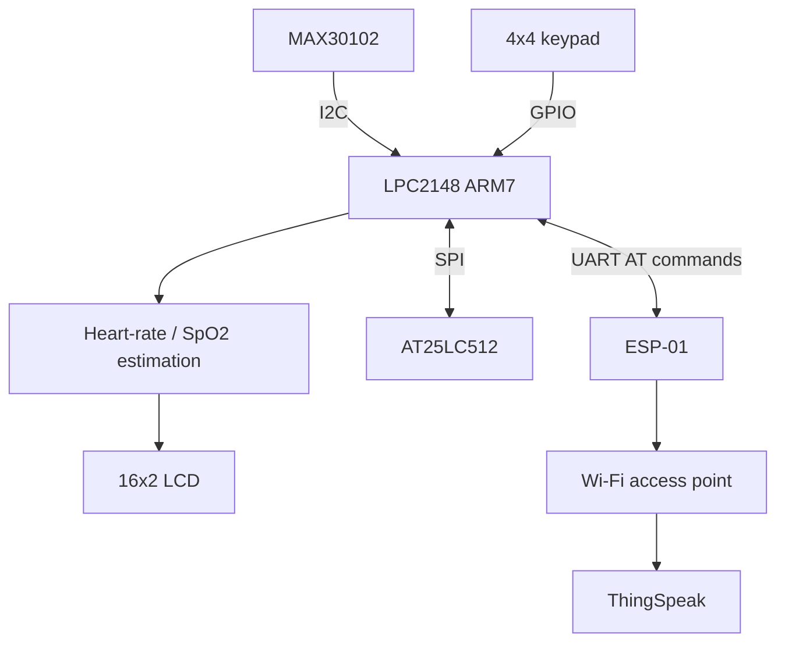

# PulseGuard — System Architecture

## Data flow

1. MAX30102 produces red and infrared optical samples.
2. LPC2148 reads the samples over I²C.
3. Firmware routines estimate heart rate and SpO₂ and evaluate finger presence.
4. The LCD presents values, configuration, and status messages.
5. The keypad allows the user to interact with supported settings.
6. Selected configuration values are stored in external SPI EEPROM.
7. ESP-01 sends configured data to ThingSpeak over Wi-Fi.

## Validation notes

- Confirm the exact sensor and LCD wiring against the physical board.
- Validate calculated readings against a trusted reference before drawing conclusions.
- Verify ThingSpeak receipt in the channel feed; an LCD status message is not server-side proof.
